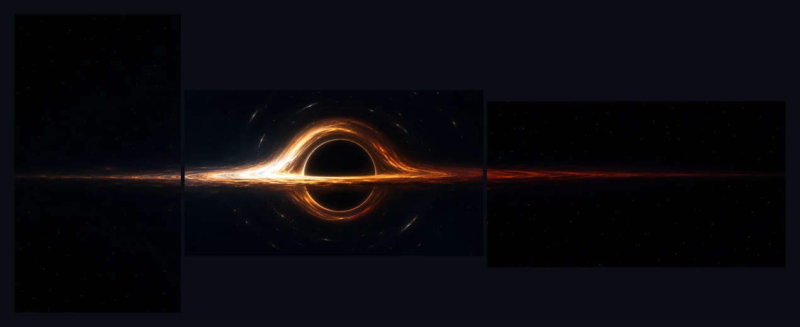

# Multimonitor Background

A background for [Omarchy](https://omarchy.org) on more than one monitor. Omarchy shows the same wallpaper on every screen; with this plugin a wallpaper can bring a left and a right panel, so one scene runs across three screens, past the bezels, or each side screen shows a picture of its own.



*The black hole from the [Gargantuan](https://github.com/thepixelgardener-create/omarchy-gargantuan-theme) theme across three screens.*

Wallpapers without panels, video wallpapers, transitions, intros and the background switcher all work exactly as before: the plugin is Omarchy's own background service with one change.

## Install

```bash
omarchy plugin add https://github.com/thepixelgardener-create/omarchy-multimonitor-background.git --enable
omarchy restart shell
```

Enabling it switches Omarchy's built-in background off; the restart makes sure the shell runs the plugin's code fresh.

To go back to the built-in background:

```bash
omarchy plugin disable thepixelgardener.multimonitor-background
omarchy plugin enable omarchy.background
```

## How screens are chosen

The **main screen** is the one with the most physical pixels; on a tie, the one nearest the middle. It shows the wallpaper itself. The screen directly to its left shows the left panel and the screen directly to its right the right panel, when the wallpaper has them. Every other screen, and every screen whose panel is missing, shows the wallpaper, as without the plugin.

Each image fills its screen the way Omarchy's wallpapers do, scaled to cover and cropped at the edges, so a panel made for a portrait screen still fills a landscape one.

## Adding panels to a wallpaper

Put the panels in a `spans` folder beside the wallpaper, in a folder named after it, with the wallpaper's file extension:

```
backgrounds/
├── 01-gargantuan.webp            the wallpaper, on the main screen
└── spans/
    └── 01-gargantuan/
        ├── left.webp             the screen to the left of the main screen
        └── right.webp            the screen to the right
```

That works for a theme's own `backgrounds/` folder and for your own wallpapers in `~/.config/omarchy/backgrounds/<theme>/`. Omarchy only lists the files directly in those folders, so the panels never turn up as wallpapers of their own. A wallpaper may have only one of the two panels.

**For one scene across the screens**, compose the panels as the parts of a wider picture that lie beyond the wallpaper's edges, at the same scale, and size each panel for the screen it is meant for. The seams fall on the bezels, so the panels line up best when they were made for the layout they are shown on. [Gargantuan](https://github.com/thepixelgardener-create/omarchy-gargantuan-theme) ships nine such scenes and the scripts that made them.

**For a different picture per screen**, any images will do.

## Checking what each screen shows

```bash
omarchy-shell background spans       # the file on each screen
omarchy-shell background spanState   # the full state, if a screen looks wrong
```

If a screen stays black or shows the wrong panel, `omarchy restart shell` puts it right; please open an issue with the `spanState` output.

## Limits

- The panels are found by name, so a wallpaper and its panels must share the file extension.
- The plugin is a copy of the background service from Omarchy 4.0. When Omarchy changes its own background service, the copy does not follow; if anything about wallpapers misbehaves after an Omarchy update, switch back to the built-in with the two commands above.
- The lock screen still shows the wallpaper on every screen; it is drawn by Omarchy's lock, not by the background service.

## License

MIT. The plugin is a modified copy of Omarchy's background service, which is MIT-licensed as well; [LICENSE](LICENSE) carries both notices. The preview image is from the Gargantuan theme.
